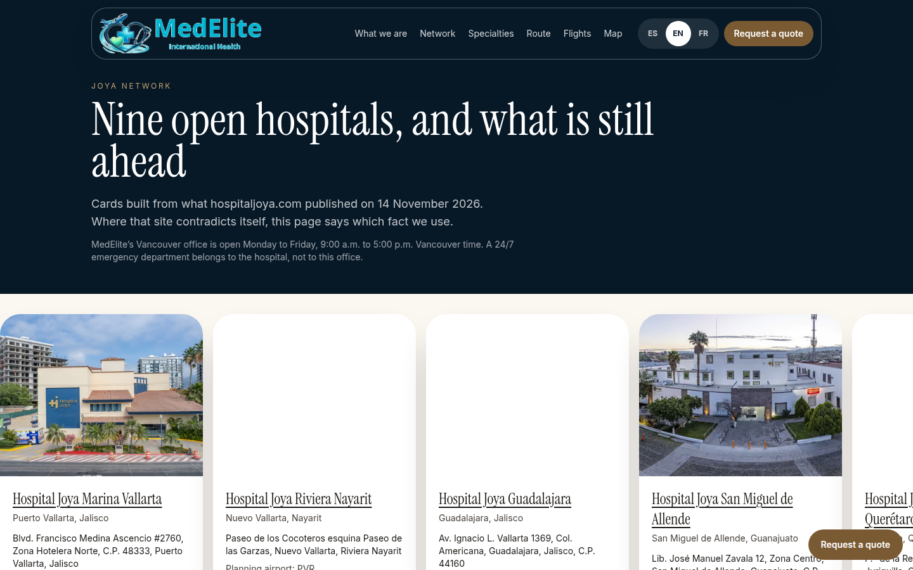
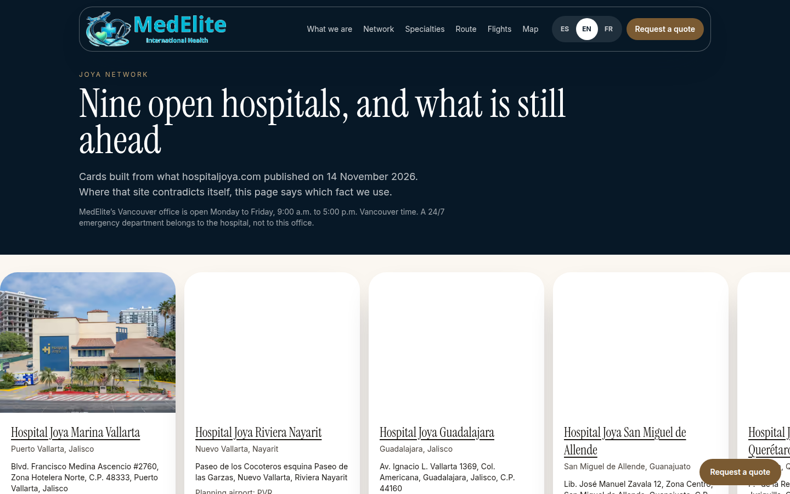
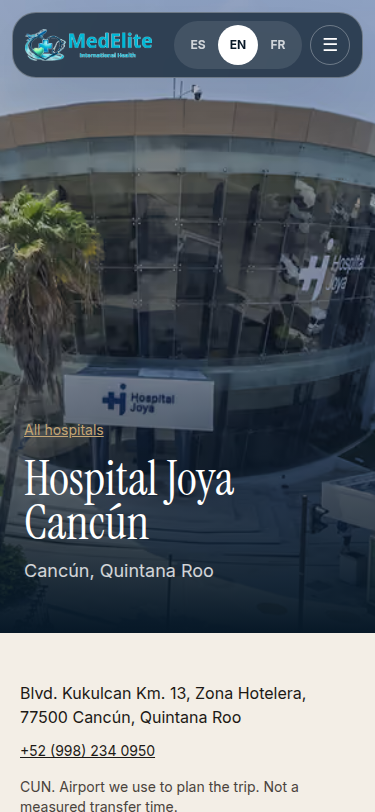
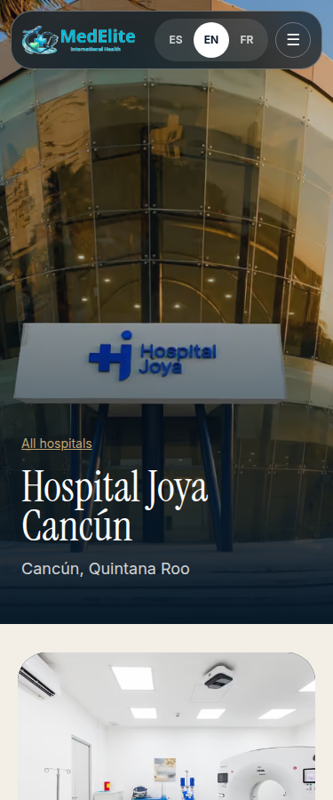

# Evidencia — fotos de Grupo Médico Joya

Fecha: 2026-11-15. Rama `cursor/joya-photos-b5e5`, tomada de `main` en `34b6fb34b347f781049474262112114db09d66e5`.

Esto no certifica ISO. Registra qué fotos se usaron, de dónde salieron, cómo se probaron y qué resultado dieron. El dueño autorizó el uso: permiso de Dr. Joya y del hospital. El índice de la colección está en el archivo que se recibió (`INDICE.csv`, 101 fotos).

## Requisito

Sustituir las fotos pequeñas de las nueve sedes por fachadas reales, y mostrar quirófano, habitación, tomógrafo y vestíbulo, más retratos del equipo ya publicado. Mantener Motion, Tailwind, la paleta navy y es/en/fr. Excluir el render de Manzanillo y cualquier imagen con pacientes. AVIF y WebP con anchos reales, carga perezosa salvo la foto principal, medidas explícitas, y la URL de origen de cada archivo usado.

## ISO/IEC/IEEE 12207

### Análisis

La colección trae fachadas, interiores y retratos. Varias filas del índice no coinciden con la imagen: el archivo llamado fachada de Marina es un quirófano; el llamado recepción de Playa es una habitación; el llamado tomógrafo de Riviera es un retrato con una imagen clínica en pantalla; el de San Miguel llamado tomógrafo o resonador es el interior de una ambulancia. Esas no se usaron para lo que el nombre decía. El render `hospital-joya-manzanillo-render-manzanillo-01.jpg` no se copió.

### Diseño

Las fachadas reemplazan el archivo de cada sede, así que la ficha, la red y el hero que ya citan ese nombre muestran la foto nueva sin una ruta nueva. La galería de la portada y la franja de Cancún y Playa usan ids nuevos. Los retratos solo aparecen junto a la persona que el sitio ya nombra. `src/data/photoCredits.ts` guarda archivo, página de origen y URL.

### Construcción

Quince fotos de lugar y doce retratos. Anchos 640, 960 y 1280 solo cuando el original da para ese ancho, sin ampliar. WebP y AVIF. El mayor WebP es `sma-1280.webp`, 139 976 bytes, bajo el tope de 140 000. La carpeta `public/assets/photos` queda en 102 archivos y 4 058 657 bytes.

### Pruebas

| Comando | Resultado | Código |
| --- | --- | --- |
| `npm run lint` | sin avisos | 0 |
| `npm run typecheck` | sin avisos | 0 |
| `npm test` | 5 archivos, 18 pruebas | 0 |
| `npm run build` | `budget ok: JS gzip max 78340, total 226183, foto max 139976 (sma-1280.webp)` | 0 |

La ficha de Cancún, en 375 px, muestra la entrada de cristal y debajo el tomógrafo. La red, en 1440 px, abre con la fachada de Marina. El hero usa la misma entrada de Cancún.

### Entrega

El merge a `main` dispara «Deploy GitHub Pages». El número de esa ejecución se anota al cerrar.

### Mantenimiento

Para volver a las fotos anteriores, revertir el commit de esta rama. Los créditos quedan en `src/data/photoCredits.ts`.

## ISO/IEC 25010

| Característica | Resultado |
| --- | --- |
| Adecuación | Nueve fachadas reales. Galería: quirófano, habitación, tomógrafo, vestíbulo. Doce retratos de personas ya listadas |
| Eficiencia | Foto máxima 139 976 bytes. JS gzip máximo 78 340, total 226 183. Dentro de 90 000 / 280 000 / 140 000 |
| Usabilidad | `alt` en es/en/fr en `PHOTO_OF`. Retratos con el nombre de la persona. Ancho y alto reales en el `img` |
| Seguridad | Sin script, dependencia ni origen nuevo. Las imágenes son del propio sitio |

## ISO/IEC 25012

Cada foto usada tiene `sourcePageUrl` e `imageUrl` en `src/data/photoCredits.ts`. Donde el índice y la imagen no coincidían, el crédito dice qué se ve de verdad. No se inventaron sedes, nombres ni datos clínicos.

## ISO/IEC 27001

El cambio va por pull request. No hay secretos ni datos de pacientes en el diff. Las fotos con pacientes se dejaron fuera.

## OWASP ASVS y Top 10

No hay script nuevo ni cambio de CSP. `img-src` sigue en `'self'`. Los retratos y las salas cargan en diferido. La fachada del hero de Cancún sigue con prioridad alta porque es la primera imagen de la portada.

## Qué se usó

| Id en el sitio | Dónde | Qué es |
| --- | --- | --- |
| marina, riviera, guadalajara, sma, queretaro, cancun, playa, chapala, penita | Ficha, red y, en Cancún, Riviera y Marina, el hero | Fachada de esa sede |
| operating-room | Portada y especialidades | Quirófano vacío, sede no nombrada |
| patient-room | Portada, bariátrica y ficha de Playa | Habitación vacía de Playa del Carmen |
| bariatric-or | Página bariátrica | Quirófano vacío publicado con el material de Marina |
| bariatric-room | Página bariátrica | Habitación vacía, sede no nombrada |
| cancun-ct, cancun-lobby | Portada y ficha de Cancún | Tomógrafo y vestíbulo, vacíos |
| Doce ids de persona | `/equipo` | Retrato publicado de esa persona |

## Capturas

Antes, red a 1440 px:

Después, red a 1440 px:

Antes, Cancún a 375 px:

Después, Cancún a 375 px:

## Resultado

Las nueve sedes tienen fachada real. La galería muestra quirófano, habitación, tomógrafo y vestíbulo sin pacientes. El render de Manzanillo no está. Lint, tipos, 18 pruebas y el build terminaron en 0, con la foto más pesada por debajo de 140 000 bytes.
